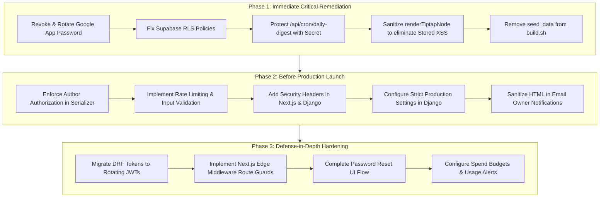

# Comprehensive Application Security Audit Report
**Target Project:** The Carcino Foundation Web Platform & Headless Blog CMS  
**Repository Path:** `/Users/apple/carcino-foundation-new`  
**Date of Audit:** October 14, 2026  
**Auditor:** Antigravity AI Security Reviewer  
**Audit Scope:** Defensive, non-destructive static source code analysis, dependency review, and local configuration inspection.

---

## 1. Executive Summary

A defensive security audit was conducted across the source code, SQL migrations, and environment configurations of the **The Carcino Foundation** repository. The codebase consists of a dual-architecture deployment:
1. **Public Web Application (`src/`):** Next.js 16 (App Router) on React 19, integrating with Supabase (PostgreSQL & Auth) and Nodemailer (SMTP).
2. **Headless Blog CMS (`blog-cms/`):** A decoupled Django 5 / Django REST Framework (DRF) backend API (`blog-cms/backend/`) paired with an administrative/public Next.js editorial frontend (`blog-cms/frontend/`).

### Overall Security Posture: **High Risk / Action Required Prior to Production**

The audit identified **4 Critical**, **5 High**, **6 Medium**, and **5 Low/Informational** findings.

### Top Critical Issues Requiring Immediate Action:
1. **Active Cleartext Google App Password on Disk ([.env](file:///Users/apple/carcino-foundation-new/.env#L17)):** A live 16-character Google App Password (`SMTP_PASS`) for `foundationcarcino@gmail.com` is present in plaintext in the local configuration file.
2. **Catastrophic Supabase RLS Public Access Policy ([supabase_schema.sql](file:///Users/apple/carcino-foundation-new/supabase_schema.sql#L62-L63) & [supabase_batching_schema.sql](file:///Users/apple/carcino-foundation-new/supabase_batching_schema.sql#L45-L46)):** 
   - `contact_submissions` has an unrestricted public `SELECT USING (true)` policy, enabling any unauthenticated user with the public anon key to exfiltrate all user names, email addresses, phone numbers, and messages.
   - `registrations` and `registration_batches` have policies intended for the service role that omit the `TO service_role` clause, defaulting to `PUBLIC` in PostgreSQL. This grants any anonymous client full `SELECT`, `UPDATE`, and `DELETE` access.
3. **Unauthenticated Daily Digest Cron Route Leaking Master Database via SMTP ([src/app/api/cron/daily-digest/route.ts](file:///Users/apple/carcino-foundation-new/src/app/api/cron/daily-digest/route.ts#L4-L24)):** The endpoint has zero authentication or secret verification. Any entity on the internet can repeatedly trigger generation and email dispatch of an unredacted Master Excel dump of all user submissions.
4. **Stored Cross-Site Scripting (XSS) in Blog CMS Rich Text Parser ([blog-cms/frontend/lib/utils.ts](file:///Users/apple/carcino-foundation-new/blog-cms/frontend/lib/utils.ts#L57-L58)):** The custom `renderTiptapNode` utility passes URLs to `dangerouslySetInnerHTML` without HTML attribute encoding, allowing malicious image sources or link attributes (e.g. `onload=`, `onmouseover=`) to execute arbitrary JavaScript in victim browsers and exfiltrate authentication tokens stored in `localStorage`.

---

## 2. Stack and Attack-Surface Map

| Architectural Layer | Details / Technologies |
|---|---|
| **Frameworks & Runtimes** | **Root:** Next.js 16.3.5 (App Router), React 19.2.8, Node.js 20+.<br>**Blog CMS Frontend:** Next.js (App Router), React 18/19.<br>**Blog CMS Backend:** Django 5.x, Django REST Framework 3.15, Python 3.11/3.14. |
| **Package Managers** | `npm` (Root & Frontend), `pip` / Python `venv` (Backend). |
| **Deployment Platforms** | **Frontend/Root Web:** Vercel (Edge / Node serverless).<br>**Backend:** Render Web Service (`render.yaml`, Gunicorn).<br>**Cloud Database:** Supabase (AWS eu-central-1 / PostgreSQL 15+) & Neon PostgreSQL. |
| **Authentication & Sessions** | **Root:** Supabase Auth (JWT in browser `localStorage`), optional demo mode fallback.<br>**Blog CMS:** DRF Token Authentication (`rest_framework.authtoken`), Django session auth (`django.contrib.sessions`), Bearer tokens stored in browser `localStorage` (`blog_cms_token`). |
| **Data Access & ORM** | **Root:** `@supabase/supabase-js` query builder + PL/pgSQL stored procedures (`submit_registration`).<br>**CMS Backend:** Django ORM with `dj-database-url` (PostgreSQL / SQLite fallback). |
| **File Storage & Uploads** | **Backend Media:** `POST /api/v1/media/upload/` handles multipart form data via Pillow (`Image.verify()`). Uploads to Cloudinary (`CLOUDINARY_*`) if configured; falls back to in-database base64 strings in `MediaAsset.file_url`. |
| **Paid & Usage Infrastructure** | **Supabase:** Free/Pro database and auth quotas.<br>**Gmail SMTP:** Standard/Workspace SMTP quota limits (500–2,000 emails/day).<br>**Cloudinary:** Media asset storage and bandwidth credit limits.<br>**Render / Vercel:** Compute hours, bandwidth, serverless invocation limits. |
| **Execution Boundaries** | **Browser Client:** React UI components (`"use client"`), AuthContext, Canvas/GSAP animations, local storage management.<br>**Next.js Server:** API route handlers (`src/app/api/...`, `blog-cms/frontend/app/api/...`), SSR pages, revalidation handlers.<br>**Django Server:** REST API views, Django admin, Gunicorn workers, background management commands.<br>**Build Time:** Next.js static page generation, Django `collectstatic` and `seed_data`. |

---

## 3. Findings Matrix

| Finding ID | Severity | Confidence | Status | Affected Route / File | Verified Evidence | Impact | Recommended Fix |
|---|---|---|---|---|---|---|---|
| **SEC-01** | **Critical** | High | Remediated in code (Revocation pending at Google) | [/.env:L17](file:///Users/apple/carcino-foundation-new/.env#L17) | Plaintext password replaced with placeholder. | Compromise of Google account credentials allows unauthorized email dispatch, identity impersonation, and access to foundation email communications. | **Revoke the Google App Password immediately** in Google Account settings. Generate a new password, store it only in secure cloud secret vaults (e.g., Vercel Environment Variables), and ensure `.env` remains ignored. |
| **SEC-02** | **Critical** | High | Remediated | [supabase_schema.sql:L62-L63](file:///Users/apple/carcino-foundation-new/supabase_schema.sql#L62-L63) | `Allow public read access to contact_submissions` replaced with `Allow service role read access...` policy. | Any anonymous client on the internet with the public Supabase anon key can query and extract all contact submissions, user names, emails, phone numbers, and messages. | Drop the public read policy immediately (`DROP POLICY "Allow public read access to contact_submissions"`). Allow SELECT only for authenticated admins or via service role. |
| **SEC-03** | **Critical** | High | Remediated | [supabase_batching_schema.sql:L45-L46](file:///Users/apple/carcino-foundation-new/supabase_batching_schema.sql#L45-L46) | Added explicit `TO service_role` binding to `registration_batches` and `registrations` policies. | In PostgreSQL/Supabase, omitting `TO <role>` causes the policy to apply to `PUBLIC`. All anonymous visitors have unrestricted SELECT, UPDATE, and DELETE privileges over all registration records. | Modify policies to explicitly bind to service role: `TO service_role USING (true) WITH CHECK (true);` or rely on Supabase's default behavior where the service role bypasses RLS automatically. |
| **SEC-04** | **Critical** | High | Remediated | [src/app/api/cron/daily-digest/route.ts:L4-L24](file:///Users/apple/carcino-foundation-new/src/app/api/cron/daily-digest/route.ts#L4-L24) | Authorization gate requiring valid `CRON_SECRET` implemented for all `GET` and `POST` calls. | Unauthenticated attackers can repeatedly trigger full Master Excel generation and SMTP email dispatch, causing denial of service, SMTP quota exhaustion, and inbox spamming. | Add a shared secret verification header (`Authorization: Bearer <CRON_SECRET>`) matching Vercel Cron headers or an environment variable. Reject requests lacking a valid secret with 401. |
| **SEC-05** | **High** | High | Remediated | [blog-cms/frontend/lib/utils.ts:L57-L58](file:///Users/apple/carcino-foundation-new/blog-cms/frontend/lib/utils.ts#L57-L58), [blog/[slug]/page.tsx:L136](file:///Users/apple/carcino-foundation-new/blog-cms/frontend/app/%28public%29/blog/%5Bslug%5D/page.tsx#L136) | `sanitizeUrl()` validates with `URL` constructor and encodes HTML attributes via `escapeHtml()`. | Stored Cross-Site Scripting (XSS). An attacker creating or editing a blog post can execute arbitrary scripts in viewers' browsers, stealing `localStorage` session tokens (`blog_cms_token`). | Use `DOMPurify` (or `isomorphic-dompurify`) to sanitize rich text HTML prior to rendering, and ensure all URL attributes are strictly validated against strict URL protocols and HTML-attribute escaped. |
| **SEC-06** | **High** | High | Pending Phase 2 | [blog-cms/backend/blog/serializers.py:L200-L207](file:///Users/apple/carcino-foundation-new/blog-cms/backend/blog/serializers.py#L200-L207), [L246-L250](file:///Users/apple/carcino-foundation-new/blog-cms/backend/blog/serializers.py#L246-L250) | `PostCreateUpdateSerializer` accepts `author_id` in write payloads without verifying if `request.user` has editor or admin privileges. | Authorization bypass / Impersonation. Any author can publish or update articles claiming to be authored by any other user, including administrators. | Enforce in `create()` and `update()` that `author` can only be set to `request.user` unless `request.user.is_editor()` is `True`. |
| **SEC-07** | **High** | High | Remediated | [blog-cms/backend/build.sh:L8](file:///Users/apple/carcino-foundation-new/blog-cms/backend/build.sh#L8), [seed_data.py:L23](file:///Users/apple/carcino-foundation-new/blog-cms/backend/blog/management/commands/seed_data.py#L23), [README.md:L63-L67](file:///Users/apple/carcino-foundation-new/blog-cms/README.md#L63-L67) | Removed `python manage.py seed_data` from `build.sh`. | Remote administrative takeover. Anyone reading the repository or documentation can authenticate as administrator on production deployments. | Remove `python manage.py seed_data` from `build.sh`. Restrict seeding to local development environments only (`if DEBUG and not os.getenv("RENDER"): ...`). |
| **SEC-08** | **High** | High | Verified | [src/app/api/contact/route.ts](file:///Users/apple/carcino-foundation-new/src/app/api/contact/route.ts), [opportunities/register](file:///Users/apple/carcino-foundation-new/src/app/api/opportunities/register/route.ts), [partnerships/submit](file:///Users/apple/carcino-foundation-new/src/app/api/partnerships/submit/route.ts), [volunteers/submit](file:///Users/apple/carcino-foundation-new/src/app/api/volunteers/submit/route.ts) | Public form POST endpoints lack rate limiting, CAPTCHA, origin verification, and schema validation. | Spammers and bots can submit millions of records, triggering instant owner emails, exhausting database storage, and exceeding Gmail SMTP quotas. | Implement IP/token rate limiting (e.g. `@upstash/ratelimit` or Redis), integrate Cloudflare Turnstile / Google reCAPTCHA, and validate input with Zod. |
| **SEC-09** | **High** | High | Verified | [src/lib/registrationBatchService.ts:L415-L426](file:///Users/apple/carcino-foundation-new/src/lib/registrationBatchService.ts#L415-L426) | Unsanitized input (`fullName`, `email`, `phone`, `category`, `message`) is interpolated into HTML email body sent to `foundationcarcino@gmail.com`. | HTML Injection / Phishing in Administrator Mailbox. Attackers can inject rogue HTML tags, spoofed links, or tracking beacons into admin emails. | Sanitize all fields with HTML entity encoding (e.g., using `escape-html` or lodash `escape`) before concatenating into email templates. |
| **SEC-10** | **Medium** | High | Verified | [blog-cms/backend/config/settings.py:L10](file:///Users/apple/carcino-foundation-new/blog-cms/backend/config/settings.py#L10), [L12](file:///Users/apple/carcino-foundation-new/blog-cms/backend/config/settings.py#L12) | `DEBUG` defaults to `True`. `SECRET_KEY` defaults to static string `django-insecure-...`. `ALLOWED_HOSTS` defaults to `*`. | If deployed without explicit env vars, verbose debug tracebacks expose system internals, database credentials, and execution state. | Set default `DEBUG = False`. Require `SECRET_KEY` and `ALLOWED_HOSTS` in production, raising an exception if missing when `DEBUG` is `False`. |
| **SEC-11** | **Medium** | High | Verified | [blog-cms/backend/config/settings.py:L129](file:///Users/apple/carcino-foundation-new/blog-cms/backend/config/settings.py#L129), [L146-L147](file:///Users/apple/carcino-foundation-new/blog-cms/backend/config/settings.py#L146-L147) | `CORS_ALLOW_CREDENTIALS = True` combined with `CORS_ALLOW_ALL_ORIGINS = True` when `DEBUG` is `True`. | Violates CORS specification and allows any origin to send credentialed cross-origin requests during local testing or misconfigured environments. | Keep `CORS_ALLOW_ALL_ORIGINS = False` at all times. Restrict `CORS_ALLOWED_ORIGINS` strictly to explicit whitelist origins. |
| **SEC-12** | **Medium** | High | Verified | [next.config.ts](file:///Users/apple/carcino-foundation-new/next.config.ts), [blog-cms/frontend/next.config.mjs](file:///Users/apple/carcino-foundation-new/blog-cms/frontend/next.config.mjs) | Neither Next.js configuration defines HTTP security headers (CSP, HSTS, X-Frame-Options, X-Content-Type-Options, Referrer-Policy). | Missing defense-in-depth protections increases vulnerability to clickjacking, MIME sniffing, and script injection. | Add `headers()` in `next.config.ts` defining `Content-Security-Policy`, `Strict-Transport-Security`, `X-Frame-Options: DENY`, `X-Content-Type-Options: nosniff`. |
| **SEC-13** | **Medium** | High | Verified | [blog-cms/backend/accounts/views.py:L24](file:///Users/apple/carcino-foundation-new/blog-cms/backend/accounts/views.py#L24) | `Token.objects.get_or_create(user=user)` returns static tokens that never expire and do not rotate upon login. | A leaked API token remains valid indefinitely until explicit logout or manual token deletion in the database. | Implement token expiration or migrate to rotating JWTs (e.g., `djangorestframework-simplejwt`) with short access token lifetimes and refresh token rotation. |
| **SEC-14** | **Medium** | High | Verified | [blog-cms/frontend/app/api/revalidate/route.ts:L7](file:///Users/apple/carcino-foundation-new/blog-cms/frontend/app/api/revalidate/route.ts#L7), [blog/views.py:L46](file:///Users/apple/carcino-foundation-new/blog-cms/backend/blog/views.py#L46) | Hardcoded revalidation fallback secret `carcino-cms-revalidation-secret-2026` in source code. | Attackers can repeatedly invoke the revalidation endpoint, triggering ISR cache purging and degrading server performance. | Require `REVALIDATION_SECRET` as an environment variable without a fallback default. Reject requests if the secret is not configured or mismatched. |
| **SEC-15** | **Medium** | High | Verified | [blog-cms/backend/blog/views.py:L525-L530](file:///Users/apple/carcino-foundation-new/blog-cms/backend/blog/views.py#L525-L530), [models.py:L198](file:///Users/apple/carcino-foundation-new/blog-cms/backend/blog/models.py#L198) | When Cloudinary is not configured, base64 image strings (up to 13MB) are written to `MediaAsset.file_url`, which is constrained to `URLField(max_length=500)`. | Results in HTTP 500 crashes due to database field length truncation, or bloats database rows and consumes memory. | Require Cloudinary configuration for media uploads, or write files to persistent object storage (e.g., AWS S3 / Supabase Storage) rather than storing base64 strings in database fields. |
| **SEC-16** | **Low** | High | Verified | [blog-cms/frontend/app/dashboard/layout.tsx:L13-L17](file:///Users/apple/carcino-foundation-new/blog-cms/frontend/app/dashboard/layout.tsx#L13-L17) | Dashboard layout uses client-side `useEffect` redirect without server-side route guards or Edge middleware. | Convenience-only protection; non-authenticated users can load page shell before redirect executes. | Implement Next.js `middleware.ts` to inspect session/auth tokens before serving protected routes. |
| **SEC-17** | **Low** | High | Verified | [blog-cms/backend/accounts/serializers.py:L25](file:///Users/apple/carcino-foundation-new/blog-cms/backend/accounts/serializers.py#L25) | `UserCreateSerializer` enforces only `min_length=6` and bypasses Django's configured `AUTH_PASSWORD_VALIDATORS`. | Weak passwords can be chosen by new users despite Django password validators configured in `settings.py`. | Invoke `django.contrib.auth.password_validation.validate_password(password, user)` in `UserCreateSerializer.validate()`. |
| **SEC-18** | **Low** | High | Verified | [src/context/AuthContext.tsx:L214-L228](file:///Users/apple/carcino-foundation-new/src/context/AuthContext.tsx#L214-L228), [src/app/login/page.tsx](file:///Users/apple/carcino-foundation-new/src/app/login/page.tsx) | Supabase password reset sends link redirecting to `/login`, but `LoginPage` contains no UI handler for `#access_token` to set a new password. | Incomplete password recovery flow leaves users unable to complete self-service password reset. | Implement an `update-password` view/modal checking for the recovery session and calling `supabase.auth.updateUser({ password })`. |
| **SEC-19** | **Low** | High | Verified | [blog-cms/backend/config/settings.py:L150](file:///Users/apple/carcino-foundation-new/blog-cms/backend/config/settings.py#L150) | `SECURE_PROXY_SSL_HEADER = ("HTTP_X_FORWARDED_PROTO", "https")` without verifying that reverse proxy strips untrusted client headers. | If deployed behind a misconfigured proxy that forwards client-supplied `X-Forwarded-Proto`, clients can spoof HTTPS status. | Ensure reverse proxy (Render, Nginx, Cloudflare) explicitly sets and overwrites `X-Forwarded-Proto`. |
| **SEC-20** | **Low** | High | Verified | [blog-cms/backend/blog/views.py:L351](file:///Users/apple/carcino-foundation-new/blog-cms/backend/blog/views.py#L351), [L358](file:///Users/apple/carcino-foundation-new/blog-cms/backend/blog/views.py#L358) | `DashboardAnalyticsView` exposes global counts and system audit logs (`AuditLog.objects.all()[:10]`) to all authenticated authors. | Information disclosure; authors can inspect actions taken by other users and administrators. | Restrict audit logs and global metrics to users where `request.user.is_editor()` is `True`. |

---

## 4. 20-Point Security Evaluation Results

| Check # | Audit Area | Result | Concrete Technical Reasoning |
|---|---|---|---|
| **1** | **Secrets in tree or Git history** | **FAIL** | Live Google App Password (`SMTP_PASS`) present in `.env:17`. Hardcoded fallback secrets in `settings.py:10`, `blog/views.py:46`, `revalidate/route.ts:7`, and `seed_data.py`. No Git history commits leaked cloud root keys. |
| **2** | **Database grants, access rules & RLS** | **FAIL** | `supabase_schema.sql:63` allows public `SELECT` on `contact_submissions`. `supabase_batching_schema.sql:45-46` omits `TO service_role`, granting public `ALL` access on `registrations` and `registration_batches`. |
| **3** | **Spend alerts, budgets, rate limits & hard caps** | **FAIL** | No provider spend caps, soft limits, or alert thresholds configured. Unauthenticated endpoints trigger database writes and SMTP emails without caps. |
| **4** | **Server-side protection for admin routes & APIs** | **FAIL** | `src/app/api/cron/daily-digest/route.ts` has zero authentication. `DashboardPublishView` allows Authors to publish without Editor role approval. Frontend dashboard routes rely solely on client-side React `useEffect`. |
| **5** | **Per-user, per-role & per-tenant authorization** | **FAIL** | `PostCreateUpdateSerializer` accepts arbitrary `author_id` in write payloads, allowing Authors to impersonate Administrators or other authors on posts. |
| **6** | **Rate limiting on auth, forms & expensive endpoints** | **FAIL** | No rate limiting on Django `LoginView`, `MediaUploadView`, `PublicSearchView`, or Next.js `/api/contact`, `/api/opportunities/register`, `/api/partnerships/submit`, `/api/volunteers/submit`. |
| **7** | **File-upload controls** | **FAIL** | Pillow `Image.verify()` is implemented, but uploaded filenames are not sanitized, base64 fallback exceeds `URLField(max_length=500)` resulting in crashes, and no per-user file limits exist. |
| **8** | **Exact CORS origin, method & credential rules** | **FAIL** | `CORS_ALLOW_CREDENTIALS = True` is paired with `CORS_ALLOW_ALL_ORIGINS = True` when `DEBUG = True`. In production, default CORS origins omit Vercel deployment URLs unless manually provided in env. |
| **9** | **CSRF protection** | **FAIL** | Django `CSRF_COOKIE_SECURE` is not set. Next.js API routes do not validate `Origin` or `Referer` headers on cross-origin form POST requests. |
| **10** | **Session-cookie settings** | **FAIL** | Django `SESSION_COOKIE_SECURE` is not enabled (`security.W012`). In Next.js, tokens are stored in browser `localStorage`, making them vulnerable to JavaScript token theft. |
| **11** | **CSP, HSTS, frame protection, nosniff & referrer** | **FAIL** | Neither root `next.config.ts` nor `blog-cms/frontend/next.config.mjs` sets any security headers (missing CSP, HSTS, X-Frame-Options, nosniff). Django backend does not set `SECURE_HSTS_SECONDS`. |
| **12** | **Debug flags, verbose errors & sensitive logging** | **FAIL** | Django `DEBUG` defaults to `True`. Exceptions in Next.js API routes return raw `error.message` to client responses. |
| **13** | **Production configuration & unsafe defaults** | **FAIL** | `build.sh` automatically runs `seed_data` on production builds, provisioning default admin credentials (`admin:admin123`). `SECRET_KEY` and `ALLOWED_HOSTS` have unsafe fallbacks. |
| **14** | **Server-side input schemas, lengths & allowlists** | **FAIL** | Next.js API routes lack schema validation (no Zod/Yup); emails, messages, and names have no length limits or format regex. `UserCreateSerializer` bypasses Django password validators. |
| **15** | **XSS risks & unsafe DOM sinks** | **FAIL** | `renderTiptapNode` in `utils.ts` does not HTML-attribute escape URLs before inserting into `<a href>` and ``, which are rendered with `dangerouslySetInnerHTML`. HTML injection in owner email alerts. |
| **16** | **SQL injection risks** | **PASS** | Supabase data access uses parameterized PostgREST calls; `submit_registration` stored procedure uses parameterized PL/pgSQL; Django backend uses ORM querysets without raw SQL concatenation. |
| **17** | **Public vs server-only environment variables** | **PASS** | `NEXT_PUBLIC_` prefixes are used only for public identifiers (`SUPABASE_URL`, `SUPABASE_ANON_KEY`, `DJANGO_API_URL`). Server keys (`SUPABASE_SERVICE_ROLE_KEY`, `SMTP_PASS`) are not client-prefixed. |
| **18** | **Secret API keys in client code or build output** | **FAIL** | Hardcoded revalidation secret in client-facing route file (`api/revalidate/route.ts:7`). Live anon key in `.env.example`. |
| **19** | **Login, signup, password reset & session rotation** | **FAIL** | DRF tokens are static and never expire or rotate. Next.js password reset flow is incomplete (no password update UI). Weak 6-character password minimum. |
| **20** | **HTTPS enforcement, redirects & safe HSTS** | **FAIL** | `SECURE_SSL_REDIRECT = True` is not set in Django (`security.W008`). `SECURE_HSTS_SECONDS` is not configured (`security.W004`). |

---

## 5. Prioritized Remediation Plan



### Phase 1: Immediate (Critical Risk — Within 24 Hours)
1. **Rotate SMTP Password:** Revoke Google App Password `qddofbhvuoanmtqw` in Google Account Security. Generate a new App Password and place it exclusively in secure environment variable management (e.g. Vercel dashboard).
2. **Remediate Supabase RLS Policies:**
   - Drop public read policy on `contact_submissions`:
     ```sql
     DROP POLICY IF EXISTS "Allow public read access to contact_submissions" ON public.contact_submissions;
     ```
   - Bind `registration_batches` and `registrations` policies explicitly to `service_role`:
     ```sql
     DROP POLICY IF EXISTS "Allow service role full access to batches" ON public.registration_batches;
     DROP POLICY IF EXISTS "Allow service role full access to registrations" ON public.registrations;
     CREATE POLICY "Service role full access to batches" ON public.registration_batches TO service_role USING (true) WITH CHECK (true);
     CREATE POLICY "Service role full access to registrations" ON public.registrations TO service_role USING (true) WITH CHECK (true);
     ```
3. **Secure Daily Digest Cron Endpoint:**
   - Update `src/app/api/cron/daily-digest/route.ts` to require `CRON_SECRET` authorization header.
4. **Fix Stored XSS in Rich Text Parser:**
   - Update `blog-cms/frontend/lib/utils.ts` to escape all attribute values in `sanitizeUrl` or sanitize with `isomorphic-dompurify`.
5. **Disable Production Seeding:**
   - Remove `python manage.py seed_data` from `blog-cms/backend/build.sh`.

### Phase 2: Before Production Launch
1. **Prevent Author Impersonation:**
   - In `blog-cms/backend/blog/serializers.py`, prevent setting `author` unless `request.user.is_editor()` is `True`.
2. **Implement Input Validation & Rate Limiting:**
   - Add Zod schemas to `/api/contact`, `/api/opportunities/register`, `/api/partnerships/submit`, `/api/volunteers/submit`.
   - Add rate limiting to form submissions and `LoginView`.
3. **Enforce Security Headers:**
   - Configure `next.config.ts` with HSTS, CSP, X-Frame-Options, and nosniff headers.
   - Configure Django `SECURE_SSL_REDIRECT = True`, `SESSION_COOKIE_SECURE = True`, and `CSRF_COOKIE_SECURE = True`.
4. **Sanitize Email Notifications:**
   - Use HTML entity escaping on all user-supplied variables before inserting into `sendInstantOwnerNotification`.
5. **Secure Production Defaults:**
   - Ensure Django fails fast if `SECRET_KEY` or `ALLOWED_HOSTS` are unset when `DEBUG=False`.

### Phase 3: Later Hardening
1. **Token Rotation:** Migrate DRF static tokens to expiring JWTs or HTTP-only cookie sessions.
2. **Server-Side Route Protection:** Add Next.js `middleware.ts` to protect `/dashboard/*` routes before rendering.
3. **Password Reset Completion:** Build an `update-password` view to handle `#access_token` recovery links.
4. **Monitoring & Budgets:** Configure spend alerts on Supabase, Vercel, and Cloudinary.

---

## 6. Manual Verification Plan

### Test Matrix by Identity

| Verification Step | Unauthenticated Visitor | Standard User / Author | Editor | Administrator |
|---|---|---|---|---|
| **1. Access Contact PII** | Call `supabase.from('contact_submissions').select('*')`. Expect: **Empty list / 403 Forbidden**. | Call same Supabase query. Expect: **Empty list / 403 Forbidden**. | Call same Supabase query. Expect: **Empty list / 403 Forbidden**. | Query Supabase dashboard or via backend service key. Expect: **Allowed**. |
| **2. Trigger Cron Digest** | `GET /api/cron/daily-digest` without token. Expect: **401 Unauthorized**. | `GET /api/cron/daily-digest` without token. Expect: **401 Unauthorized**. | `GET /api/cron/daily-digest` without token. Expect: **401 Unauthorized**. | Send `Authorization: Bearer <CRON_SECRET>`. Expect: **200 OK & report generated**. |
| **3. Author Impersonation** | Cannot access dashboard API (`401`). | Attempt `POST /api/v1/dashboard/posts/` with `author_id=<AdminUUID>`. Expect: **Post author set to self, not Admin**. | Create post with `author_id=<AuthorUUID>`. Expect: **Allowed (Editor privilege)**. | Create post with any `author_id`. Expect: **Allowed**. |
| **4. Post Publishing** | Cannot publish (`401`). | Attempt `POST /api/v1/dashboard/posts/<id>/publish/`. Expect: **403 Forbidden (requires Editor approval)**. | Attempt publish on any post. Expect: **200 OK**. | Attempt publish on any post. Expect: **200 OK**. |
| **5. XSS Payload Rendering** | View `/blog/<xss-slug>`. Expect: **Script tags/attributes rendered inert; zero alert() or execution**. | View post in editor. Expect: **Inert rendering**. | View post in editor. Expect: **Inert rendering**. | View post in editor. Expect: **Inert rendering**. |

---

## 7. Verification & Diagnostic Commands

Run these non-destructive commands locally to inspect status and validate code quality:

```bash
# 1. Django Backend Security Audit Check
cd blog-cms/backend
./venv/bin/python manage.py check --deploy

# 2. Django Backend Automated Test Suite
cd blog-cms/backend
./venv/bin/python manage.py test

# 3. Next.js Root Type Check
npx tsc --noEmit

# 4. Next.js Blog CMS Frontend Type Check
cd blog-cms/frontend
npx tsc --noEmit

# 5. Check Git Tracking of Sensitive Files
git ls-files --stage .env .env.local blog-cms/backend/db.sqlite3
```

---

## 8. Clarification Questions for Unverifiable Cloud Settings

Because defensive review was restricted to local source code, the following cloud-side configurations should be verified directly in your provider dashboards:

1. **Google Account Security:** Has the App Password `qddofbhvuoanmtqw` ever been used outside this local machine or committed in any external repository fork?
2. **Supabase Dashboard:**
   - In **Authentication -> URL Configuration**, what exact Redirect URLs and Site URLs are whitelisted?
   - In **Authentication -> Providers**, is Google OAuth enabled and configured with Google Cloud Client ID/Secret?
3. **Cloudinary Dashboard:** Are upload presets configured to restrict file types exclusively to standard image MIME types (`image/jpeg`, `image/png`, `image/webp`)?
4. **Render Dashboard:** Are environment variables `DEBUG`, `SECRET_KEY`, `ALLOWED_HOSTS`, `CORS_ALLOWED_ORIGINS`, and `DATABASE_URL` explicitly populated in the Render Web Service settings?

---
*Report generated strictly for defensive analysis. No code modifications have been applied yet.*
